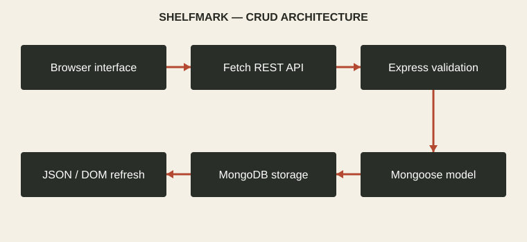

# Shelfmark — Library Inventory Ledger
**Khushi Jain Daga | 23bcon1665 | Experiment 05 | Web Development Using AI**

## Aim
Develop a CRUD-based web application using Node.js, Express.js and MongoDB with AI-assisted code generation.

## Overview
A fictional library inventory application with a terracotta, parchment and charcoal editorial interface. Register, view, edit and delete book records; search, filter, sort and see live collection totals. All records are stored in MongoDB, not localStorage.

## Stack
HTML5, CSS3, vanilla JavaScript Fetch API, Node.js, Express, Mongoose, MongoDB. AI assistant: ChatGPT.

## Architecture


Browser → Fetch REST API → Express validation → Mongoose → MongoDB → JSON response → DOM refresh.

## Setup (Windows)
Install Node.js 22 or compatible LTS and MongoDB Community Server (or configure a MongoDB Atlas connection). Ensure the local MongoDB service is running if using the default URI. Open this folder in VS Code.

```powershell
npm install
Copy-Item .env.example .env
npm start
```
Open http://localhost:8004. For Atlas, replace MONGODB_URI in .env with your connection string and configure database credentials and network access. Never commit .env. No API key required for local MongoDB.

## API
| Method | Route | Purpose |
|---|---|---|
| GET | /api/books | List records |
| GET | /api/books/:id | Read record |
| POST | /api/books | Create (201) |
| PUT | /api/books/:id | Update (200) |
| DELETE | /api/books/:id | Delete (204) |
| GET | /api/health | Database connection status |

Fields: title, author, ISBN (format check, not checksum), category, total copies, available copies. Server validates required fields, numeric limits and availability. Duplicate ISBN returns 409, invalid input 400, missing record 404.

## AI development brief
Build an original library inventory CRUD dashboard using Express and MongoDB with a distinctive editorial visual design, real persistence, server-side validation, responsive UI and visible student attribution.

## Verification
Run `npm test` for validation unit tests. Manually register a fictional book, reload, edit its stock, search, delete, reload again, test duplicate ISBN and invalid counts. Capture actual screenshots after database setup. Full database/browser integration testing has not been performed in the generation environment.

## Conclusion
The source implements the four CRUD operations through a REST API and MongoDB persistence. This local academic prototype has no authentication; do not expose it publicly without adding access controls.
